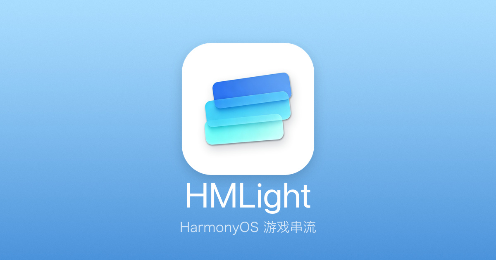

# HMLight



HarmonyOS NEXT 上的 Moonlight 游戏串流客户端。

> **非官方项目。** 本项目基于 [Moonlight](https://github.com/moonlight-stream/moonlight-common-c)
> 的协议实现修改而来，与 Moonlight 官方不存在隶属、赞助或背书关系。
> 项目名称、图标均为自有，不使用 Moonlight 的名称与图标作为产品标识。

当前版本：**v0.1.3** · 已在 HUAWEI MatePad Pro（HarmonyOS NEXT）上验证

---

## 特性

**连接与配对**

- 手动添加主机 IP，标准 4 位 PIN 配对流程
- 长按主机卡片弹出菜单：打开应用列表 / 测试网络连接 / 查看详情 / 删除电脑
- 删除带二次确认；删除当前主机时同步清理"最后使用地址"
- 连接测试带超时控制，不可达地址不会长时间卡在"刷新中"

**串流**

- 视频解码：H.264 / H.265(HEVC) 硬件解码，Native AVCodec 直接输出到 Surface，无额外拷贝
  - 可在「设置 → 视频编码」切换：自动 / 仅 H.264 / 仅 HEVC，默认「自动」由主机协商
  - HEVC 需要主机端（Sunshine / Apollo）同时启用，否则会回落到 H.264
- 音频：Opus 多流解码 + OHAudio 低延迟输出，支持立体声 / 5.1 / 7.1
- 输入：触摸（含触控板模式）、物理手柄，可调死区与翻转
- 可调分辨率 / 帧率 / 码率，支持原生分辨率与自定义缩放

**界面**

- 浅色 / 深色主题，两套独立图标与配色
- 应用列表支持自定义封面（裁剪、还原）
- 本地缓存：应用列表与封面落盘，二次进入秒开，随后后台刷新

**诊断**

- 开发者模式（设置页连点版本号 5 次开启）
- 诊断日志独立开关，可查看占用大小并一键清空
- 日志仅在本机沙箱，不含串流画面与网络内容

## 技术架构

```
ArkTS (UI)  ──NAPI──▶  C++ bridge  ──▶  moonlight-common-c
                          │
                          ├─ AVCodec (视频硬解 → Surface)
                          ├─ OHAudio (音频输出)
                          └─ mbedTLS (mTLS / 配对)
```

- 界面：ArkTS / ArkUI，页面与状态均在 `entry/src/main/ets`
- 协议：`moonlight-common-c` 原样复用，仅新增一个 UDP 计数接口
- 桥接：`entry/src/main/cpp/bridge`，通过 NAPI 暴露给 ArkTS

## 环境要求

| 项 | 要求 |
| --- | --- |
| 开发环境 | DevEco Studio，HarmonyOS SDK **26.0.0** 及以上 |
| 编译目标 | `compatibleSdkVersion 26.0.0` / `targetSdkVersion 26.0.1` |
| 设备 | HarmonyOS NEXT 手机或平板，**arm64-v8a** |
| 服务端 | [Sunshine](https://github.com/LizardByte/Sunshine) 或 [Apollo](https://github.com/ClassicOldSong/Apollo)（均为 GameStream 兼容服务端；NVIDIA GameStream 已停止服务） |

> 本工程只编译 `arm64-v8a`，不支持 32 位设备。

## 构建

1. 用 DevEco Studio 打开本工程
2. `File → Project Structure → Signing Configs`，勾选 **Automatically generate signature**（需登录华为账号）
3. `Build → Build Hap(s) / App(s)`

或使用命令行（需先配置好签名）：

```bash
hvigorw assembleHap --mode module -p product=default
```

> 仓库中**不包含**任何签名材料（证书、profile、密码），这是有意为之。
> 未配置签名时构建会失败，属预期行为。

## 目录结构

```
AppScope/                  应用级配置与图标资源
entry/
  src/main/ets/            ArkTS 界面与服务
    pages/                 首页 / 应用列表 / 串流 / 设置 / 帮助 / 封面裁剪
    services/              主机存储、NAPI 封装、封面加载与缓存
    common/                主题与路由参数
  src/main/resources/      字符串、颜色、深浅色图标、启动页
  src/main/cpp/
    CMakeLists.txt         原生构建入口
    bridge/                NAPI 桥：nvhttp / videodec / audiodec / gamepad / diag
    types/                 NAPI 类型声明（libmoonbridge）
    third_party/           随仓库分发的第三方源码
patches/                   对 upstream 的补丁
scripts/                   依赖拉取与诊断采集脚本
Icon/                      图标设计稿
```

## 第三方源码

`third_party/` 下的源码**随仓库直接分发**，不使用 submodule，克隆后无需额外拉取：

| 组件 | 许可证 | 版本 |
| --- | --- | --- |
| moonlight-common-c | GPL-3.0 | `94c65fd`（含本项目补丁） |
| ENet | MIT | `98dbb89` |
| Mbed TLS（含 framework） | Apache-2.0 / GPL-2.0-or-later | `82e6999` / `ced3149` |
| Opus | BSD-3-Clause | `31b4b36` |
| nanors | MIT | `a9b1636` |

完整 commit、来源与许可证见 [`entry/src/main/cpp/third_party/VERSIONS.md`](entry/src/main/cpp/third_party/VERSIONS.md)
与 [`NOTICE`](NOTICE)。

> `scripts/setup_deps.sh` 仅用于**从零初始化** `third_party/`。本仓库已包含全部源码，
> 目录非空时脚本会自动跳过，正常开发无需运行它。

## 修改说明

相对 upstream 的主要修改：

| 文件 | 修改 |
| --- | --- |
| `third_party/moonlight-common-c/src/PlatformSockets.c` | 新增 UDP 接收字节计数接口，供诊断页统计码率 |
| `bridge/nvhttp.cpp` | mTLS 客户端证书生成与持久化、配对流程、`launch` / `appasset` 请求、UDP 读取上限修正、非阻塞连接与超时 |
| `bridge/videodec.cpp` | 改用 HarmonyOS Native AVCodec + Surface 输出，加入关键帧等待与色彩范围处理 |
| `bridge/audiodec.cpp` | Opus 多流解码 + OHAudio 输出，支持立体声 / 5.1 / 7.1 |
| `bridge/bridge_napi.cpp` | NAPI 桥接层、输入事件、控制器、诊断与统计接口 |
| `bridge/diag.cpp` | JSONL 诊断日志，支持查询大小与清空 |
| `entry/src/main/ets/**` | 全部界面与本地缓存实现 |

## 隐私

- 仅申请 `ohos.permission.INTERNET`，无定位、无通讯录、无存储权限
- 诊断日志默认关闭，仅写入应用沙箱，不会上传
- 配对证书保存在应用私有目录

## 许可证

本项目以 **GNU General Public License v3.0** 发布，全文见 [LICENSE](LICENSE)。

由于链接了 GPLv3 的 moonlight-common-c，本项目整体（含所有修改）同样以 GPLv3 授权。
分发二进制时请同时提供对应源码。

## 已知限制

- 仅支持 arm64-v8a
- 未实现 HDR 串流
- 未实现局域网自动发现（需手动输入主机 IP）
- 未实现多显示器 / 多会话切换
- 手机端布局已适配，但仅在平板上做过完整功能验证

## 反馈

欢迎提交 Issue。涉及串流问题请附上：设备型号、HarmonyOS 版本、服务端类型与版本，
以及开发者模式导出的诊断日志（请先自行检查其中是否包含不希望公开的网络信息）。
